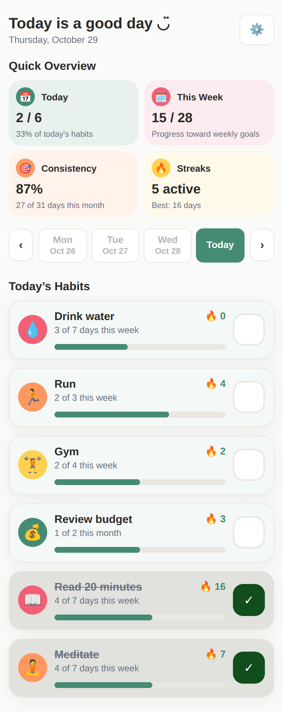
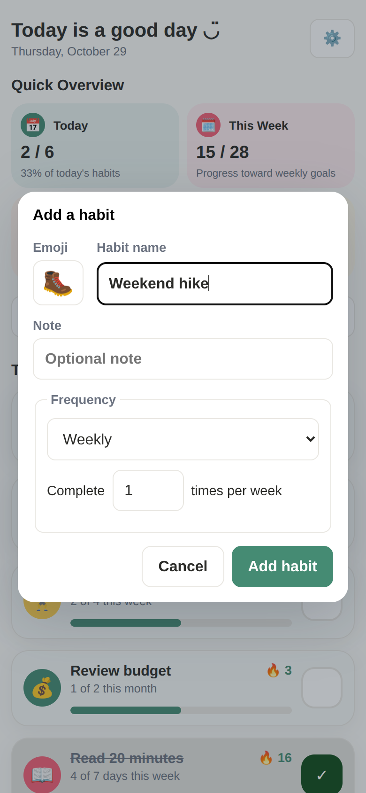
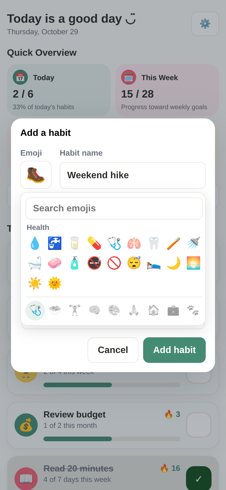
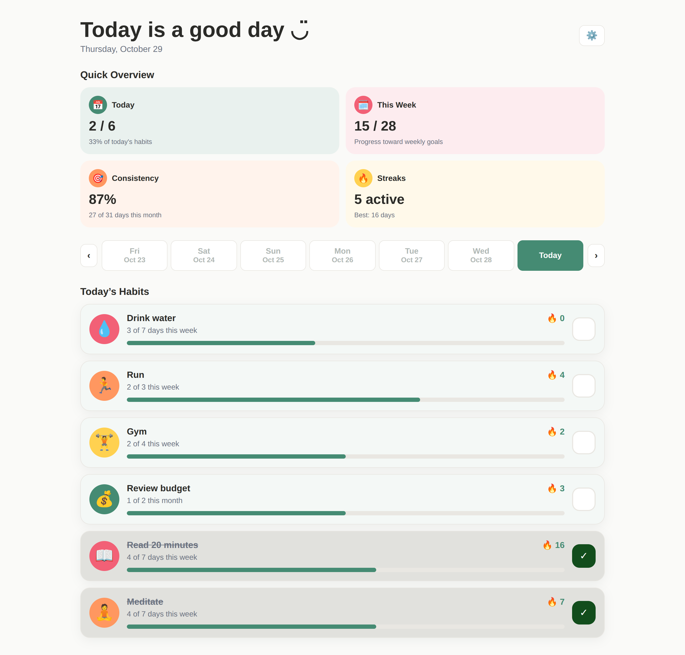

# Habit Tracker

A simple habit tracker that runs in your browser. No sign up, no install, no server. Everything is in one HTML file.

## Screenshots

  
  
  

## Features

- **Daily, weekly and monthly habits.** Set a habit to repeat every day, or choose a goal like "3 times per week" or "10 times per month". The specific days do not matter.
- **Streaks that follow your schedule.**
  - Daily: consecutive days completed.
  - Weekly: consecutive weeks (Monday to Sunday) where you reached your goal.
  - Monthly: consecutive calendar months where you reached your goal.
  - A week or month that is still in progress will not break your streak.
- **Quick Overview.** Four cards show how you are doing:
  - Today: habits completed out of your total.
  - This Week: progress toward your weekly goals.
  - Consistency: the percentage of days this month with at least one habit completed.
  - Streaks: how many streaks are active, plus your best one.
- **Progress on every habit.** See how many days or times you have completed this week or month.
- **Check off past days.** Use the day picker at the top to log a day you missed. Future days are locked.
- **Emoji picker.** Choose from categories like Health, Food, Fitness and Mind, or search by keyword.
- **Completed habits move to the bottom.** Habits are grouped as daily, then weekly, then monthly.
- **Backup and restore.** Export your data as a file and import it later or on another device.
- **Works on mobile.** The layout adapts to phone screens.

## How to use it

1. Open `index.html` in any modern browser, or use the live link if the project is published.
2. Tap the settings icon in the top right and choose **Add Habit**.
3. Pick an emoji, name your habit and choose how often you want to do it.
4. Tap the box on the right of a habit to mark it done.

To change or delete a habit, open settings and choose **Manage Habits**.

## Publish it with GitHub Pages

1. In your repository, click **Settings**.
2. In the left menu, click **Pages**.
3. Under **Branch**, choose **main** and click **Save**.
4. Wait about a minute and refresh the page. Your live link will appear at the top.

## Your data

- Habits are saved in your browser using `localStorage`. They stay on your device and are never sent anywhere.
- Data is separate for each browser and each device.
- Clearing your browser data will erase your habits, so use **Export data** from time to time to keep a backup.
- **Import data** replaces your current habits with the ones in the file.

## Built with

Plain HTML, CSS and JavaScript. No libraries, no build step.

## License

This project is licensed under the MIT License. See the `LICENSE.txt` file for details.
